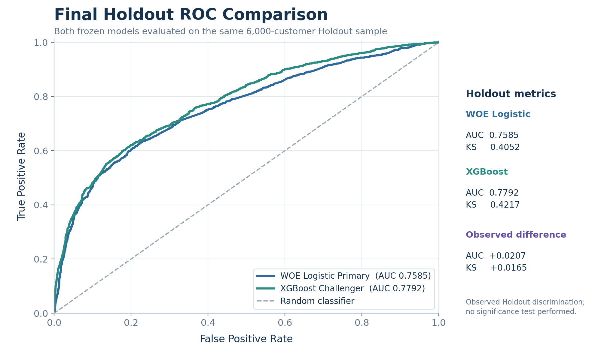
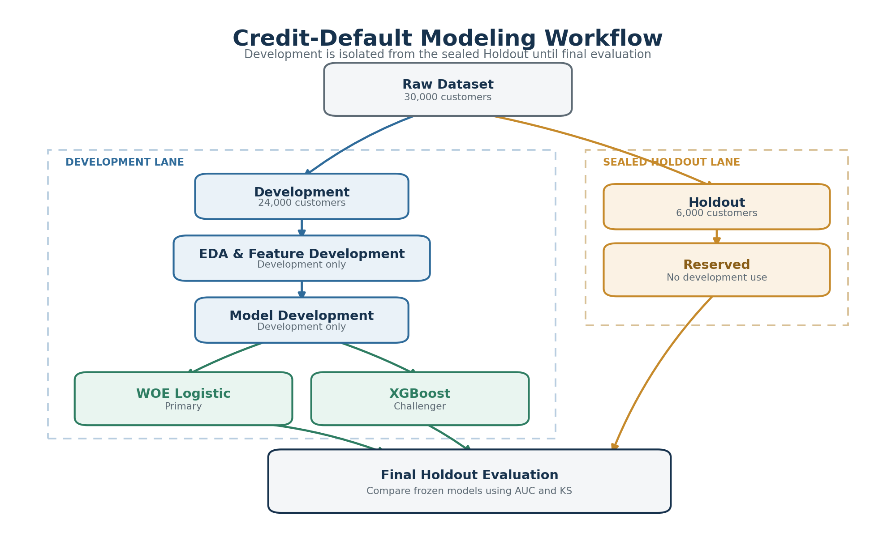

# Credit Card Default Risk Modeling: Interpretable WOE Logistic vs. XGBoost

This portfolio project models **next-month default risk for existing credit-card customers** and compares two deliberately different approaches: an interpretable Weight of Evidence (WOE) Logistic Regression primary model and a nonlinear XGBoost challenger.

Model development was confined to a 24,000-customer Development sample. After both model specifications were frozen, they were evaluated once on the same 6,000-customer Holdout sample. The XGBoost challenger produced stronger Holdout discrimination, while the compact WOE Logistic model retained a clearer explanation and governance profile.

## Final Holdout Results

| Frozen model | Role | Holdout AUC | Holdout KS |
|---|---|---:|---:|
| 10-variable WOE Logistic Regression | Interpretable primary | 0.7585 | 0.4052 |
| XGBoost, 26 conceptual predictors / 29 encoded columns | Nonlinear challenger | **0.7792** | **0.4217** |

On this fixed Holdout sample, the challenger improved AUC by **0.0207** and KS by **0.0165** relative to the primary. These are observed out-of-sample differences from one Holdout comparison; no formal significance test was performed. The result supports a practical tradeoff rather than an automatic replacement decision: XGBoost ranked default risk more effectively, while WOE Logistic remains substantially easier to interpret and explain.

*Both curves use the same 6,000-row Holdout sample; the corresponding KS values are 0.4052 and 0.4217.*

## Business Problem

The objective is behavioral credit-default discrimination: using recent repayment, delinquency, payment, balance, credit-limit, and utilization information to distinguish customers with higher versus lower likelihood of default in the following month.

This kind of ranking evidence can support portfolio monitoring and risk review, where predictive power and transparent reasoning both matter. The project does not build an application-underwriting, approval, pricing, credit-limit, or regulatory probability-of-default system.

## Data and Validation Design

The analysis uses the UCI Machine Learning Repository's [Default of Credit Card Clients](https://archive.ics.uci.edu/dataset/350/default) dataset, covering 30,000 credit-card customers in the Taiwan-associated source population.

| Item | Design |
|---|---|
| Raw data | 30,000 observations and 25 columns |
| Target | `default.payment.next.month` (`1` = default, `0` = non-default) |
| Development sample | 24,000 observations used for feature and model development |
| Holdout sample | 6,000 observations reserved for final comparison |
| Internal validation | Fixed stratified five-fold cross-validation where appropriate |
| Final evaluation | One same-sample Holdout comparison after both models were frozen |

The Development/Holdout separation prevents final-sample results from driving feature, binning, or model-selection decisions. Detailed dataset provenance and handling are documented in [`data/README.md`](data/README.md).

*Feature and model development remain inside the Development lane; Holdout reconnects only for final evaluation.*

## Modeling Approach

### Interpretable primary: WOE Logistic Regression

The primary follows a credit-risk-oriented workflow rather than a generic classifier fit:

- structured binning and Weight of Evidence transformation;
- Information Value and redundancy-informed variable screening;
- stability review across stratified Development folds;
- a compact final set of 10 behavioral and exposure predictors;
- an unpenalized Logistic refit with directional interpretation.

This design prioritizes transparency: each predictor enters through documented bins and WOE mappings, and the final coefficient structure can be reviewed directly.

### Nonlinear challenger: XGBoost

The challenger uses a broader feature universe of 26 conceptual predictors represented by 29 encoded columns. It captures nonlinear effects and interactions across repayment status, delinquency persistence, payment history, billing and credit exposure, and utilization. Its model selection was performed using Development-only cross-validation before the final specification was applied to Holdout.

The challenger offers stronger observed discrimination, but with higher model complexity and a less direct explanation path than the WOE Logistic primary.

## Key Modeling Decisions

- **Two purposeful model roles.** The project compares an interpretable credit-risk benchmark with a nonlinear challenger instead of assembling a broad model zoo.
- **Credit-risk-oriented Logistic design.** WOE, IV, structured binning, redundancy checks, and coefficient stability support a reviewable primary model.
- **Behavior-based feature engineering.** Repayment status, delinquency history, monthly payments, balances, limits, and utilization summarize how customers manage existing credit.
- **Development and final evaluation remain distinct.** Feature and model decisions use Development evidence; Holdout metrics are reserved for the frozen-model comparison.

## Recommended Notebook Path

| Step | Focus | Notebook |
|---:|---|---|
| 1 | Data Preparation & EDA | [Train/Test Split & Train-only EDA](notebooks/02_train_test_split_and_eda.ipynb) |
| 2 | Feature Engineering | [Feature Engineering & Sanity Checks](notebooks/03_feature_engineering_and_sanity_checks.ipynb) |
| 3 | WOE / Binning / Variable Screening | [WOE/IV Variable Screening](notebooks/07_woe_iv_variable_screening.ipynb) |
| 4 | Final WOE Logistic Primary | [Final Logistic Freeze](notebooks/10_final_woe_logistic_freeze.ipynb) |
| 5 | XGBoost Challenger Development | [XGBoost Challenger Development](notebooks/11_xgboost_challenger_development.ipynb) |
| 6 | Final Holdout Comparison | [Final Holdout Model Comparison](notebooks/12_final_holdout_model_comparison.ipynb) |

See the [`notebooks/README.md`](notebooks/README.md) for the curated reading path and supporting development notebooks. Detailed reproducibility and review records are indexed under [`docs/audit/`](docs/audit/README.md); external-reference attribution is documented in [`references/README.md`](references/README.md).

## Scope and Limitations

- **Public case-study data.** The UCI dataset is a benchmark dataset, not evidence from a current live bank portfolio; results should not be generalized automatically to another population or time period.
- **Discrimination focus.** The project evaluates ranking performance using AUC and KS. It does not implement pricing, profitability optimization, business cutoff selection, expected-loss estimation, formal calibration, or regulatory PD validation.
- **Governance tradeoff.** XGBoost improves observed Holdout discrimination, while the WOE Logistic model remains more transparent and easier to review, communicate, and govern.
- **Portfolio—not production—scope.** The repository demonstrates a reproducible modeling case study. It is not a deployed decision engine or a claim of production readiness.

## Reproducibility

Core Python dependencies are listed in [`requirements.txt`](requirements.txt). The expected raw-data location and attribution are documented in [`data/README.md`](data/README.md). All analytical notebooks and the full audit trail remain available so the modeling path can be inspected beyond this executive summary.
